# Melo

> **Zero-spoiler, voice-first audiobook companion powered by local temporal RAG and open weights.**

[]()
[-emerald.svg)](docs/EVALS.md)
[-blue.svg)](docs/BENCHMARKS.md)
[](LICENSE)

Melo is an offline-first companion for audiobooks. Unlike conventional chatbots that ingest entire books and spoil major plot twists, Melo binds its awareness strictly to your current listening position (`t <= current_ms`). You can interrupt at any point via push-to-talk to ask who a character is, clarify a scene, or test a theory — and Melo answers in spoken audio in under two seconds without ever spoiling what comes next.

---

## Architecture & Data Flow

```mermaid
flowchart TD
    subgraph Client["Web Client (React + Vite)"]
        UI["Audio Player & Synchronized Transcript"]
        Mic["Hold-to-Talk Voice Dock"]
    end

    subgraph Server["Melo Backend (FastAPI)"]
        Orch["Query Orchestrator"]
        STT["Phonon-2.5 STT"]
        Guard["Temporal Spoiler Shield (t <= t_ms)"]
        RAG["Hybrid Retrieval (EmbeddingGemma-2 + FTS5)"]
        LLM["Gemma 4 Reasoning"]
        TTS["Kokoro-82M Streaming TTS"]
    end

    subgraph Storage["Local Storage"]
        DB[("SQLite (melo.db)")]
        AudioStore["Audio & Transcript Cache"]
    end

    Mic -->|"Voice Audio (WAV)"| STT
    STT -->|"Transcribed Question"| Orch
    UI -->|"Playhead Timestamp (t_ms)"| Guard
    Orch --> Guard
    Guard -->|"Safe Past Chunks"| RAG
    RAG <-->|"Vector + Full-Text Search"| DB
    RAG -->|"Grounded Context"| LLM
    LLM -->|"Sentence Stream"| TTS
    TTS -->|"Audio Chunks"| UI
    Orch -.->|"Log Question & Answer"| DB
    AudioStore -.->|"Stream Audio"| UI

    classDef accent fill:#132e22,stroke:#10b981,stroke-width:2px;
    class Guard accent;
```



---

## Core Capabilities

- **Zero-Spoiler Temporal Shield:** Hard cutoff on context. Chunks beyond the current playhead are filtered out before retrieval. Questions referencing future plot points are rejected immediately with a canonical refusal.
- **Sub-2s Push-to-Talk Companion:** Hold `Space` or tap the mic. Melo runs local speech-to-text (Phonon-2.5), temporal hybrid search (EmbeddingGemma-2 + SQLite FTS5), in-the-moment reasoning (Gemma 4), and streaming audio synthesis (Kokoro-82M) in ~1.9s p50 on standard CPUs.
- **Karaoke Transcript & Live Horizon:** Synchronized word-level highlighting with interactive seek. Future text is dynamically dimmed and masked in Story mode.
- **Dual Cognitive Modes:**
  - **Story Mode:** Strict zero-spoiler horizon. Answers drawn exclusively from the immediate scene and past excerpts.
  - **Study Mode:** Whole-document synthesis with clearly labeled background knowledge (`Beyond the document: ...`).
- **Lore Log:** Automatically indexes your questions, answers, and timestamps into an interactive study drawer.
- **Bring Your Own Audiobooks & Documents:** Supports `.mp3`, `.m4a`, multi-chapter `.m4b` (with automated `ffprobe` chapter detection), plus `.epub`, `.pdf` (via `anydoc`), and scanned documents via on-device `indra-ocr`.

---

## Performance & Evaluation

Tested on consumer hardware (13th Gen Intel Core i5 CPU, 16GB RAM):

| Pipeline Stage | Engine / Model | Measured Latency (p50) |
| --- | --- | ---: |
| **Speech-to-Text** | Fermion Phonon-2.5 (156 MB) | **633 ms** |
| **Temporal Retrieval** | EmbeddingGemma-2 (256d) + SQLite FTS5 | **109 ms** |
| **First Token (LLM)** | Gemma 4 4.6B (`gemma4:e2b` via Ollama) | **727 ms** |
| **First Audio Chunk (TTS)** | Kokoro-82M ONNX (`af_heart` @ 1.15x) | **522 ms** |
| **Total Voice TTFA** | **End-to-End Voice-to-Voice** | **1,970 ms** |

- **Spoiler Release Gate:** **20/20 passed (100%)** on adversarial murder/plot questions at early timestamps ([EVALS.md](docs/EVALS.md)).
- **Latency Acceptance Gate:** Passes the CPU budget gate (p50 <= 3000 ms, p95 <= 4000 ms) with margin ([BENCHMARKS.md](docs/BENCHMARKS.md)).

---

## Quick Start

### Prerequisites
- Python 3.11 or 3.12 (`uv` recommended)
- Node.js 20+ & npm
- `ffmpeg` & `ffprobe`
- ~4 GB free disk space for local models and demo audio

### Setup & Run
```bash
# 1. Install dependencies
make setup

# 2. Download local open weights (Phonon, EmbeddingGemma-2, Kokoro)
make models

# 3. Generate and index demo books (Styles Chapter 2 & Attention Paper)
make assets

# 4. Start backend (:8000) and frontend (:5173)
make dev
```
Open **`http://localhost:5173`** in your browser.

Verify prerequisites and model readiness anytime with:
```bash
make preflight
```

---

## Verification & Commands

| Command | Description |
| --- | --- |
| `make check` | Run all test suites: Ruff, pytest (55 passed), ESLint, TypeScript, Vitest. |
| `make preflight` | Audit environment, models, database, ports, and hardware readiness. |
| `make bench-gate` | Run 10-cycle voice latency benchmark and enforce CPU TTFA <= 3000 ms gate. |
| `make bench-novel` | Run latency tests across diverse, cycling novel questions. |
| `make eval` | Run the 20-question adversarial spoiler leak evaluation. |
| `make e2e` | Run end-to-end Playwright browser tests. |
| `make format` | Format Python (`ruff format`) and frontend (`prettier`) code. |

---

## Configuration

Settings can be configured via environment variables (prefixed with `MELO_` or `ECHOREAD_`) or a root `.env` file:

| Variable | Default | Description |
| --- | --- | --- |
| `MELO_PROFILE` | `cpu` | Hardware profile (`cpu` or `gpu`). |
| `MELO_HOST` | `127.0.0.1` | Backend bind host. |
| `MELO_PORT` | `8000` | Backend bind port. |
| `MELO_DATA_DIR` | `./data` | Directory for models, books, and SQLite database (`melo.db`). |
| `MELO_STT_PROVIDER` | `phonon` | Speech-to-text provider (`phonon` or `whisper`). |
| `MELO_PHONON_MODEL` | `phonon-2.5` | Profile for `fermion.load_speech`. |
| `MELO_LLM_PROVIDER` | `ollama` | LLM backend (`ollama`, `llama_cpp`, or `openai`). |
| `MELO_LLM_ENDPOINT` | `http://127.0.0.1:11434` | Endpoint for Ollama or OpenAI-compatible server. |
| `MELO_LLM_MODEL` | `gemma4:e2b` | Model tag (e.g. `gemma4:e2b`, `qwen2.5:3b`). |
| `MELO_MAX_DOCUMENT_SENTENCES` | `250` | Maximum sentence count for text documents before synthesis guard. |

---

## Privacy & Open Source

- **100% On-Device / Self-Hosted:** Speech recognition, embeddings, vector search, and audio synthesis run directly on your machine.
- **Zero Third-Party APIs:** No commercial cloud LLM APIs, telemetry, or user tracking.
- **License:** Released under the [Apache License 2.0](LICENSE). Demo assets sourced from Project Gutenberg and public research papers.
