# Melo

> **Zero-spoiler, voice-first audiobook companion powered by local temporal RAG and open weights.**

Melo is an offline-first companion for audiobooks. Unlike conventional chatbots that ingest entire books and spoil major plot twists, Melo binds its awareness strictly to your current listening position (`t <= current_ms`). You can interrupt at any point via push-to-talk to ask who a character is, clarify a scene, or test a theory — and Melo answers in spoken audio in under two seconds without ever spoiling what comes next.

---

## Architecture & Data Flow

```mermaid
flowchart TD
    subgraph Client["Web Client (React + Vite)"]
        UI["Audio Player & Synchronized Transcript"]
        Mic["Hold-to-Talk Voice Dock"]
    end

    subgraph Server["Melo Backend (FastAPI)"]
        Orch["Query Orchestrator"]
        STT["Phonon-2.5 STT"]
        Guard["Temporal Spoiler Shield (t <= t_ms)"]
        RAG["Hybrid Retrieval (EmbeddingGemma-2 + FTS5)"]
        LLM["Gemma 4 Reasoning"]
        TTS["Kokoro-82M Streaming TTS"]
    end

    subgraph Storage["Local Storage"]
        DB[("SQLite (melo.db)")]
        AudioStore["Audio & Transcript Cache"]
    end

    Mic -->|"Voice Audio (WAV)"| STT
    STT -->|"Transcribed Question"| Orch
    UI -->|"Playhead Timestamp (t_ms)"| Guard
    Orch --> Guard
    Guard -->|"Safe Past Chunks"| RAG
    RAG <-->|"Vector + Full-Text Search"| DB
    RAG -->|"Grounded Context"| LLM
    LLM -->|"Sentence Stream"| TTS
    TTS -->|"Audio Chunks"| UI
    Orch -.->|"Log Question & Answer"| DB
    AudioStore -.->|"Stream Audio"| UI

    classDef accent fill:#132e22,stroke:#10b981,stroke-width:2px;
    class Guard accent;
```



---

## Core Capabilities

- **Zero-Spoiler Temporal Shield:** Hard cutoff on context. Chunks beyond the current playhead are filtered out before retrieval. Questions referencing future plot points are rejected immediately with a canonical refusal.
- **Sub-2s Push-to-Talk Companion:** Hold `Space` or tap the mic. Melo runs local speech-to-text (Phonon-2.5), temporal hybrid search (EmbeddingGemma-2 + SQLite FTS5), in-the-moment reasoning (Gemma 4), and streaming audio synthesis (Kokoro-82M) in ~1.9s p50 on standard CPUs.
- **Karaoke Transcript & Live Horizon:** Synchronized word-level highlighting with interactive seek. Future text is dynamically dimmed and masked in Story mode.
- **Dual Cognitive Modes:**
  - **Story Mode:** Strict zero-spoiler horizon. Answers drawn exclusively from the immediate scene and past excerpts.
  - **Study Mode:** Whole-document synthesis with clearly labeled background knowledge (`Beyond the document: ...`).
- **Lore Log:** Automatically indexes your questions, answers, and timestamps into an interactive study drawer.
- **Bring Your Own Audiobooks & Documents:** Supports `.mp3`, `.m4a`, multi-chapter `.m4b` (with automated `ffprobe` chapter detection), plus `.epub`, `.pdf` (via `anydoc`), and scanned documents via on-device `indra-ocr`.

---

## Open-Weight Models & Hugging Face Registry

Melo runs open-weight models on consumer hardware without third-party cloud APIs:

| Component | Model Name | Parameters / Size | Hugging Face Link | Role in Pipeline |
| --- | --- | --- | --- | --- |
| **Speech-to-Text (Primary)** | Phonon-2.5 | 156 MB (int6) | [`FermionResearch/Phonon-2.5`](https://huggingface.co/FermionResearch/Phonon-2.5) | Fast voice recognition with per-book hotword biasing. |
| **Speech-to-Text (Fallback)** | faster-whisper (`base.en` / `small.en`) | 142 MB / 466 MB | [`Systran/faster-whisper-base.en`](https://huggingface.co/Systran/faster-whisper-base.en) | Fallback ASR running under CTranslate2. |
| **Temporal Embeddings** | EmbeddingGemma-2 | 300M (256d MRL) | [`google/embeddinggemma-2`](https://huggingface.co/google/embeddinggemma-2) | Local chunk embeddings for hybrid vector retrieval. |
| **Companion Reasoning (Default)** | Gemma 4 4.6B (`gemma4:e2b`) | 4.6B (Q4_K_M) | [`google/gemma-4-e2b`](https://huggingface.co/google) | In-the-moment reasoning, refusal enforcement, and token streaming. |
| **Offline LLM (CPU)** | Qwen2.5-1.5B-Instruct / 3B | 1.5B / 3B GGUF | [`Qwen/Qwen2.5-1.5B-Instruct-GGUF`](https://huggingface.co/Qwen/Qwen2.5-1.5B-Instruct-GGUF) | Fully offline local GGUF running via `llama-cpp-python`. |
| **Offline LLM (Gemma)** | Gemma-2-2B-It | 2.6B GGUF | [`google/gemma-2-2b-it`](https://huggingface.co/google/gemma-2-2b-it) | Alternative offline Gemma model for `llama-cpp-python`. |
| **Streaming Audio Synthesis** | Kokoro-82M | 82M (85 MB int8) | [`hexgrad/Kokoro-82M`](https://huggingface.co/hexgrad/Kokoro-82M) | Chunked streaming voice response (`af_heart` voice). |
| **Document OCR** | Indra OCR | ~120 MB ONNX | [`datalab-to/indra-ocr`](https://huggingface.co/datalab-to/indra-ocr) | Local on-device OCR for scanned EPUB/PDF pages. |

---

## Performance & Evaluation

Tested on consumer hardware (13th Gen Intel Core i5 CPU, 16GB RAM):

| Pipeline Stage | Engine / Model | Measured Latency (p50) |
| --- | --- | ---: |
| **Speech-to-Text** | Fermion Phonon-2.5 (156 MB) | **633 ms** |
| **Temporal Retrieval** | EmbeddingGemma-2 (256d) + SQLite FTS5 | **109 ms** |
| **First Token (LLM)** | Gemma 4 4.6B (`gemma4:e2b` via Ollama) | **727 ms** |
| **First Audio Chunk (TTS)** | Kokoro-82M ONNX (`af_heart` @ 1.15x) | **522 ms** |
| **Total Voice TTFA** | **End-to-End Voice-to-Voice** | **1,970 ms** |

- **Spoiler Release Gate:** **20/20 passed (100%)** on adversarial murder/plot questions at early timestamps ([EVALS.md](docs/EVALS.md)).
- **Latency Acceptance Gate:** Passes the CPU budget gate (p50 <= 3000 ms, p95 <= 4000 ms) with margin ([BENCHMARKS.md](docs/BENCHMARKS.md)).

---

## Quick Start

### Prerequisites
- Python 3.11 or 3.12 (`uv` recommended)
- Node.js 20+ & npm
- `ffmpeg` & `ffprobe`
- ~4 GB free disk space for local models and demo audio

### Setup & Run

One command — install, fetch weights, build the web bundle, ingest demo books, and serve everything from a single process on **`http://localhost:8000`**:

```bash
make start
```

Or the classic dev loop (backend :8000 + Vite HMR :5173):

```bash
# 1. Install dependencies
make setup

# 2. Download local open weights (Phonon, EmbeddingGemma-2, Kokoro)
make models

# 3. Generate and index demo books (Styles Chapter 2 & Attention Paper)
make assets

# 4. Start backend (:8000) and frontend (:5173)
make dev
```
Open **`http://localhost:5173`** in your browser.

Verify prerequisites and model readiness anytime with:
```bash
make preflight
```

---

## Verification & Commands

| Command | Description |
| --- | --- |
| `make start` | One-command run: bootstrap + single-process server at `http://localhost:8000`. |
| `make check` | Run all test suites: Ruff, pytest (55 passed), ESLint, TypeScript, Vitest. |
| `make preflight` | Audit environment, models, database, ports, and hardware readiness. |
| `make bench-gate` | Run 10-cycle voice latency benchmark and enforce CPU TTFA <= 3000 ms gate. |
| `make bench-novel` | Run latency tests across diverse, cycling novel questions. |
| `make eval` | Run the 20-question adversarial spoiler leak evaluation. |
| `make e2e` | Run end-to-end Playwright browser tests. |
| `make format` | Format Python (`ruff format`) and frontend (`prettier`) code. |

---

## Configuration

Settings can be configured via environment variables (prefixed with `MELO_` or `ECHOREAD_`) or a root `.env` file:

| Variable | Default | Description |
| --- | --- | --- |
| `MELO_PROFILE` | `cpu` | Hardware profile (`cpu` or `gpu`). |
| `MELO_HOST` | `127.0.0.1` | Backend bind host. |
| `MELO_PORT` | `8000` | Backend bind port. |
| `MELO_DATA_DIR` | `./data` | Directory for models, books, and SQLite database (`melo.db`). |
| `MELO_STT_PROVIDER` | `phonon` | Speech-to-text provider (`phonon` or `whisper`). |
| `MELO_PHONON_MODEL` | `phonon-2.5` | Profile for `fermion.load_speech`. |
| `MELO_LLM_PROVIDER` | `ollama` | LLM backend (`ollama`, `llama_cpp`, or `openai`). |
| `MELO_LLM_ENDPOINT` | `http://localhost:11434` | Endpoint for Ollama or OpenAI-compatible server. |
| `MELO_LLM_API_KEY` | *(empty)* | Bearer token for `openai`-compatible hosted providers (Groq, OpenRouter, OpenAI, ...). |
| `MELO_LLM_MODEL` | `gemma4:e2b` | Model tag (e.g. `gemma4:e2b`, `qwen2.5:3b`). |
| `MELO_MAX_DOCUMENT_SENTENCES` | `250` | Maximum sentence count for text documents before synthesis guard. |

Copy [`.env.example`](.env.example) to `.env` to configure any of these — it ships commented examples for every provider below.

### Bring Your Own LLM

The reasoning model is pluggable. Pick whichever fits your setup:

| Provider | `MELO_LLM_PROVIDER` | `MELO_LLM_ENDPOINT` | `MELO_LLM_API_KEY` | Notes |
| --- | --- | --- | --- | --- |
| Ollama (local) | `ollama` | `http://localhost:11434` | — | Default. Any local Ollama tag via `MELO_LLM_MODEL`. |
| Bundled GGUF (offline) | `llama_cpp` | — | — | Zero setup: uses the Qwen2.5-1.5B Q4 GGUF from `make models`. |
| **Groq (free tier)** | `openai` | `https://api.groq.com/openai/v1` | your key | Fastest free option; `llama-3.3-70b-versatile` is a solid `MELO_LLM_MODEL`. |
| OpenRouter | `openai` | `https://openrouter.ai/api/v1` | your key | Includes free-tier models. |
| OpenAI | `openai` | `https://api.openai.com/v1` | your key | |
| LM Studio (local) | `openai` | `http://localhost:1234/v1` | — | Local server, keyless. |
| llama.cpp server (local) | `openai` | `http://localhost:8080/v1` | — | Keyless `--host` mode. |

---

## Deployment

### Docker (local)

```bash
docker compose up --build
```
Open **`http://localhost:8000`**. The `./data` directory is mounted, so books, uploads, and the database survive rebuilds; model weights are fetched into the volume on first run.

### Azure Container Apps (free-tier demo link)

Deploys a public, scale-to-zero URL from the repo:

```bash
azd auth login
azd up
```

`azd` builds the Docker image, provisions the resources in [`infra/`](infra/main.bicep), and prints the public `APP_URL`. What it creates:

- **Container Apps environment (Consumption plan)** with the app at 2 vCPU / 4 GiB, **min replicas 0** — idle cost is exactly $0.
- **Free monthly grant:** 180,000 vCPU-seconds + 360,000 GiB-seconds + 2M requests ≈ **25 hours** of 2 vCPU/4 GiB runtime per month, which comfortably covers a demo link. Set `maxReplicas: 1` keeps it from scaling out and burning the grant.
- **Log Analytics** capped at 7-day retention / 5 GB-month ingest (stays inside its free allowance).
- **Azure Container Registry (Basic)** is the one resource the grant doesn't cover (~$5/month — covered by Azure free-account credits, and the only cost if the app stays scaled down). For a fully $0 pipeline on a public GitHub repo, publish the image from GitHub Actions to GHCR instead and point the container at it.

Notes for demos:

- **Cold start:** after idling to zero, the first hit pays an image pull + model load (~1–3 min). Warm it before presenting: `curl <APP_URL>/api/health` until `"ready": true`.
- **LLM:** the default is the bundled Qwen2.5-1.5B GGUF (offline). For a snappier demo, plug in Groq's free API:
  ```bash
  azd env set ECHOREAD_LLM_PROVIDER openai
  azd env set ECHOREAD_LLM_ENDPOINT https://api.groq.com/openai/v1
  azd env set ECHOREAD_LLM_API_KEY gsk_...
  azd provision   # or re-run azd up
  ```
- **Storage is ephemeral** while scaled to zero: uploaded books and the DB reset on cold start. The two demo books are baked into the image, so the demo always works; persistent storage (e.g. an Azure Files mount) is the upgrade path if you outgrow the demo.

---

## Privacy & Open Source

- **100% On-Device / Self-Hosted by default:** Speech recognition, embeddings, vector search, and audio synthesis run directly on your machine.
- **No cloud LLM unless you opt in:** There are no built-in third-party APIs — if you want a hosted reasoner, you wire in your own provider and API key (see [Bring Your Own LLM](#bring-your-own-llm)). No telemetry, no user tracking.
- **License:** Released under the [Apache License 2.0](LICENSE). Demo assets sourced from Project Gutenberg and public research papers.
