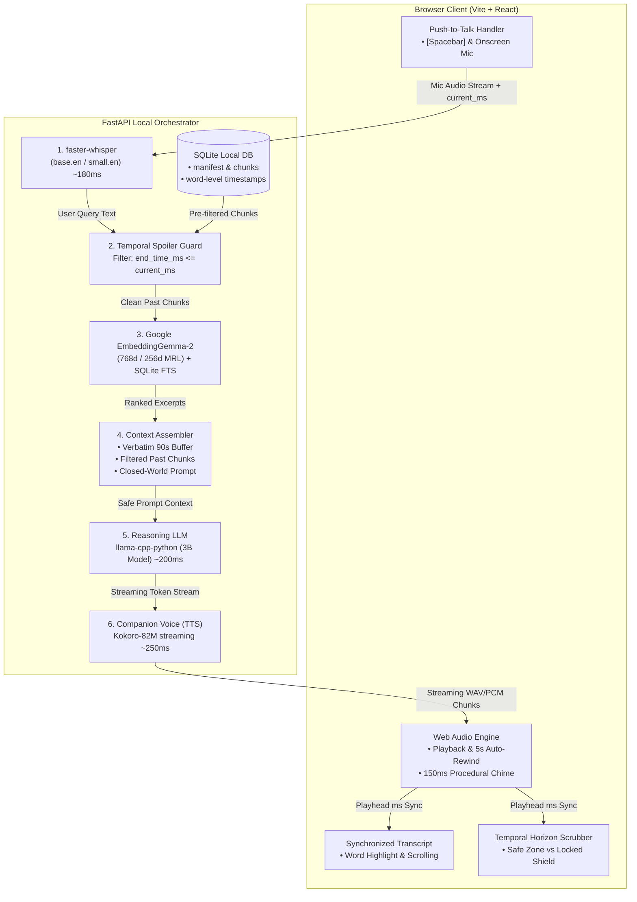
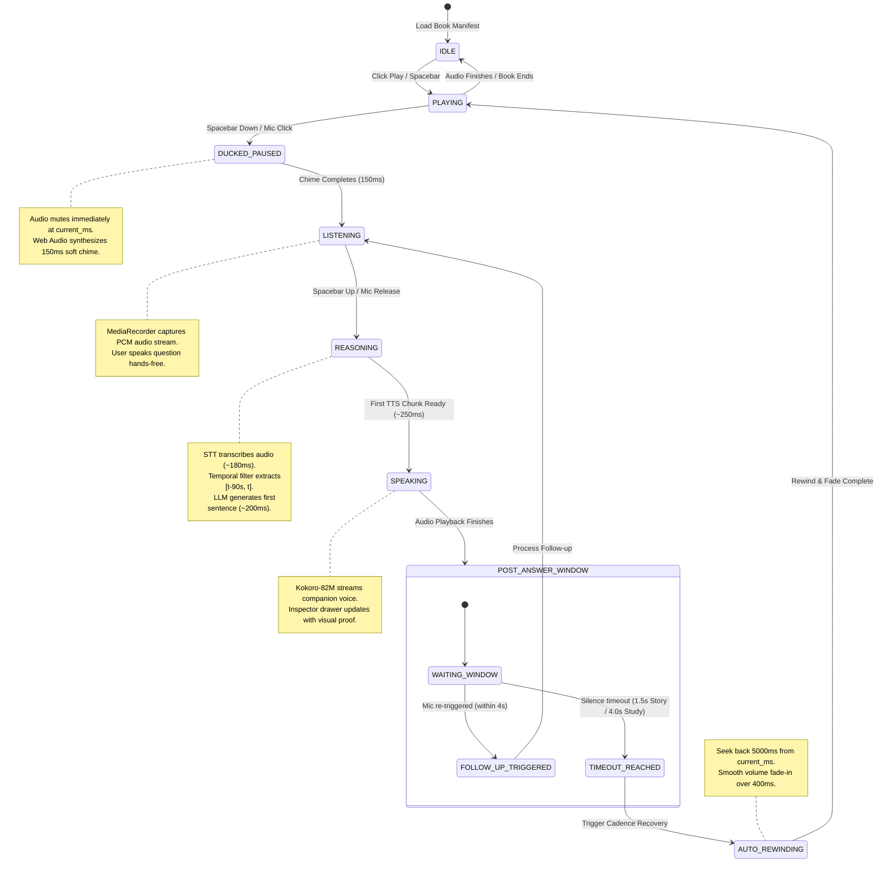

# EchoRead: Architecture Diagrams & Finite State Machines (FSMs)

This document specifies the end-to-end system architecture and lifecycle state machines for the EchoRead MVP. 

An editable, native Excalidraw canvas is also generated and ready to open:  
👉 **Excalidraw Canvas File:** [echoread-architecture-and-fsm.excalidraw](file:///home/sanjeev/Downloads/echoread/echoread-architecture-and-fsm.excalidraw) *(Drag & drop into [excalidraw.com](https://excalidraw.com) or open with VS Code Excalidraw extension)*.

---

## 1. System Architecture & Component Data Flow



---

## 2. FSM 1: Audio Playback & Voice Interrupt Cycle

This state machine controls player ducking, the acoustic readiness chime, mic streaming, and the 5,000ms narrative auto-rewind.



### State Transition Invariant Table

| Source State | Event / Trigger | Target State | State Action & Safety Invariants |
| :--- | :--- | :--- | :--- |
| `PLAYING` | `keydown [Spacebar]` | `DUCKED_PAUSED` | Instant volume duck to 0; record `current_playback_ms`; trigger 150ms oscillator chime. |
| `DUCKED_PAUSED` | `chime.onended` | `LISTENING` | Start `MediaRecorder`; stream audio buffers; display "Listening..." UI badge. |
| `LISTENING` | `keyup [Spacebar]` | `REASONING` | Stop recording; send audio blob + `current_playback_ms` to `/api/voice-query`. |
| `REASONING` | `tts_chunk_1_ready` | `SPEAKING` | Begin Web Audio decoding of incoming PCM chunks; animate companion waveform. |
| `SPEAKING` | `tts_stream.onended`| `POST_ANSWER_WINDOW` | Start silence countdown timer (1.5s in Story Mode, 4.0s in Study Mode). |
| `POST_ANSWER_WINDOW` | `timeout_expired` | `AUTO_REWINDING` | Seek to `max(0, current_playback_ms - 5000)`; initiate 400ms volume fade-in. |
| `AUTO_REWINDING` | `fade_complete` | `PLAYING` | Normal playback restored; rolling 90s context tracking resumes. |

---

## 3. FSM 2: Temporal Spoiler Guard & Context Assembly

This state machine enforces the mathematical temporal boundary to guarantee zero plot leaks.

```mermaid
flowchart TD
    A([User Query Received]) --> B[Extract current_playback_ms & book_id]
    B --> C{Listening Mode?}

    %% Story Mode Branch
    C -->|Story Mode| D[Apply Hard Temporal SQL Filter]
    D --> E["WHERE end_time_ms <= current_playback_ms"]
    E --> F[Prune all forward chunks]
    F --> G[Construct Closed-World Prompt:<br/>'Use ONLY provided excerpts; do NOT leak unreached lore']
    
    %% Study Mode Branch
    C -->|Study Mode| H[Open Global Scope]
    H --> I["Full document search + Glossary + Web Synthesis"]
    I --> J[Construct Socratic Tutor Prompt]

    %% Convergence
    G --> K[Assemble Immediate 90s Verbatim Buffer<br/>Range: [current_ms - 90s, current_ms]]
    J --> K
    K --> L[Hybrid Dense Vector + BM25 Rank Fusion]
    L --> M([Dispatch Context to LLM Generator])

    classDef story fill:#2c1424,stroke:#f43f5e,stroke-width:2px,color:#ffe4e6;
    classDef study fill:#142c22,stroke:#10b981,stroke-width:2px,color:#d1fae5;
    classDef core fill:#1a2432,stroke:#0284c7,stroke-width:2px,color:#e0f2fe;

    class D,E,F,G story;
    class H,I,J study;
    class K,L,M core;
```

---

## 4. Key Verification Criteria for Implementation

1. **Spacebar Debouncing:** Prevent keyboard auto-repeat from triggering multiple `DUCKED_PAUSED` transitions when held down.
2. **Audio Clamping:** When in the first 5 seconds of a book (`current_playback_ms < 5000`), the auto-rewind clamps to `0ms` without crashing.
3. **Strict Query Pre-Filtering:** Verification test must confirm 0% recall of chapter $N+1$ entities when playing chapter $N$.
4. **Latency Earcon Masking:** The 150ms readiness chime + 100ms thinking tone masks the STT + RAG execution time so user-perceived delay remains under 850ms.
